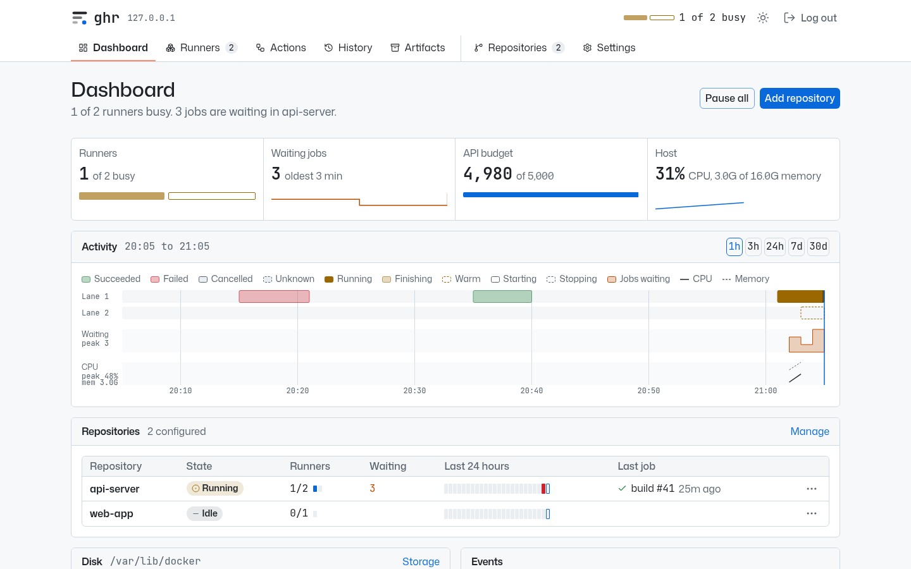

<h1 align="center">ghr</h1>

<p align="center">
  <strong>Self-hosted GitHub Actions runners on one Linux host, with a web UI.</strong>
</p>

<p align="center">
  <a href="https://github.com/darkraise/ghr/actions/workflows/ci.yml"></a>
  <a href="https://github.com/darkraise/ghr/releases/latest"></a>
  <a href="LICENSE"></a>
  <a href="go.mod"></a>
</p>

<picture>
  <source media="(prefers-color-scheme: dark)" srcset="docs/images/dashboard-dark.png">
  
</picture>

ghr is a single binary that runs GitHub Actions jobs for your repositories on one Debian or Ubuntu host. It watches for queued jobs, starts a fresh single-use runner for each, and cleans up when the job ends.

Jobs run natively on the host, not in a container, so Docker, Docker Compose and Testcontainers behave as they do on a developer machine. There is no Kubernetes cluster to operate, as [Actions Runner Controller](https://github.com/actions/actions-runner-controller) requires, and no Docker-in-Docker.

## Features

- **Single-use runners**: a fresh just-in-time runner per job, removed by GitHub afterwards.
- **Scheduling**: a global cap with per-repository limits, or warm idle runners for instant starts.
- **Resource limits**: each runner is a systemd unit with its own memory and CPU limits.
- **Cleanup**: compose projects and job containers are removed when a runner ends; Docker is pruned when the disk fills.
- **Web UI**: live dashboard, workflow runs with job graphs and searchable logs, job history and all settings, behind a password.
- **Toolchains and packages**: pre-installed Node, Python, Go, Java and .NET for `setup-*` actions, shared package caches, and managed apt packages.
- **Artifacts**: track GitHub artifact storage against your plan, or keep artifacts on your own S3 server such as RustFS.
- **Updates**: ghr tracks new releases of itself and the runner, and installs them without interrupting running jobs.

## Requirements

- A dedicated x86-64 host (LXC or VM) running Debian 13 or Ubuntu 22.04, 24.04 or 26.04, with root access. On Proxmox, an LXC needs `features: nesting=1,keyctl=1`.
- A fine-grained GitHub token for the repositories to serve, with **Administration: read/write** and **Actions: read/write**.

See [Installation](docs/installation.md) for optional permissions and unattended installs.

## Quick start

1. **Install.** As root on the host:

   ```bash
   curl -fsSL https://github.com/darkraise/ghr/releases/latest/download/setup.sh | bash
   ```

   The installer sets up Docker, the GitHub Actions runner and the `ghr` service. Re-run it to upgrade.

2. **Finish setup.** Open `http://<host>:8080/setup` and enter the setup code the installer printed (`ghr code` shows it again). Then set a web password, enter your GitHub owner and token, and choose repositories and toolchains.

3. **Use the runners.** Target them by label in your workflows:

   ```yaml
   jobs:
     build:
       runs-on: [self-hosted, linux, x64]
   ```

   Every runner carries `self-hosted`, `linux` and `x64`, plus any labels you configure globally or per repository.

The web UI is plain HTTP. Finish setup from a trusted network, and put a [TLS proxy](docs/web-ui.md#behind-a-reverse-proxy) in front of it for regular use.

## Everyday use

Everything in the web UI is also available from the `ghr` command on the host:

```bash
ghr status                    # repositories, runners and health
ghr repo add <name>           # serve another repository
ghr set max <repo> <n>        # limit a repository's concurrent runners
ghr pause <repo>              # stop starting runners; running jobs finish
ghr history                   # recent jobs
ghr update ghr                # install the latest ghr release
journalctl -u ghr -f          # the daemon's log
```

The configuration lives in `/etc/ghr/config.yaml`. See [Configuration](docs/configuration.md) for every setting and command.

## How it works

ghr runs as a systemd service and polls the GitHub API for queued jobs. When a job is waiting and the limits allow it, ghr requests a just-in-time runner from GitHub and starts it with `systemd-run` as the `ghrunner` user. The runner takes exactly one job. When it exits, ghr removes the Docker resources the job created and the runner's working directory.

Containers started with plain `docker run` are removed only if their names match the repository's `cleanup_name_prefixes`, so give them a prefix or use `--rm`.

## Security

ghr runs jobs natively, so anyone who can run a workflow on it effectively has root on the host:

- Use a dedicated host and run nothing else on it.
- All served repositories share one trust domain: a job in one can read the GitHub token and affect the jobs of the others. Serve only repositories whose workflow authors you trust.
- ghr refuses public repositories unless `allow_public` is set, and refuses jobs triggered from forks. Never enable "Run workflows from fork pull requests" on a served repository.

[SECURITY.md](SECURITY.md) covers the full threat model, including `issue_comment` and merge queue workflows, and how to report a vulnerability.

## Documentation

- [Installation](docs/installation.md): requirements, token permissions, unattended installs and upgrades
- [Configuration](docs/configuration.md): every setting and the command line
- [Web UI](docs/web-ui.md): password, listen address and reverse proxies
- [Toolchains and caches](docs/toolchains.md): toolchains, system packages, package caches and Docker pruning
- [Artifact storage](docs/artifact-storage.md): the GitHub storage quota, retention and cleanup
- [Self-hosted artifacts](docs/self-hosted-artifacts.md): storing artifacts on your own S3 server

## Contributing

Bug reports and pull requests are welcome. See [CONTRIBUTING.md](CONTRIBUTING.md) for the development setup, tests and commit conventions.

## License

ghr is released under the [MIT License](LICENSE).
